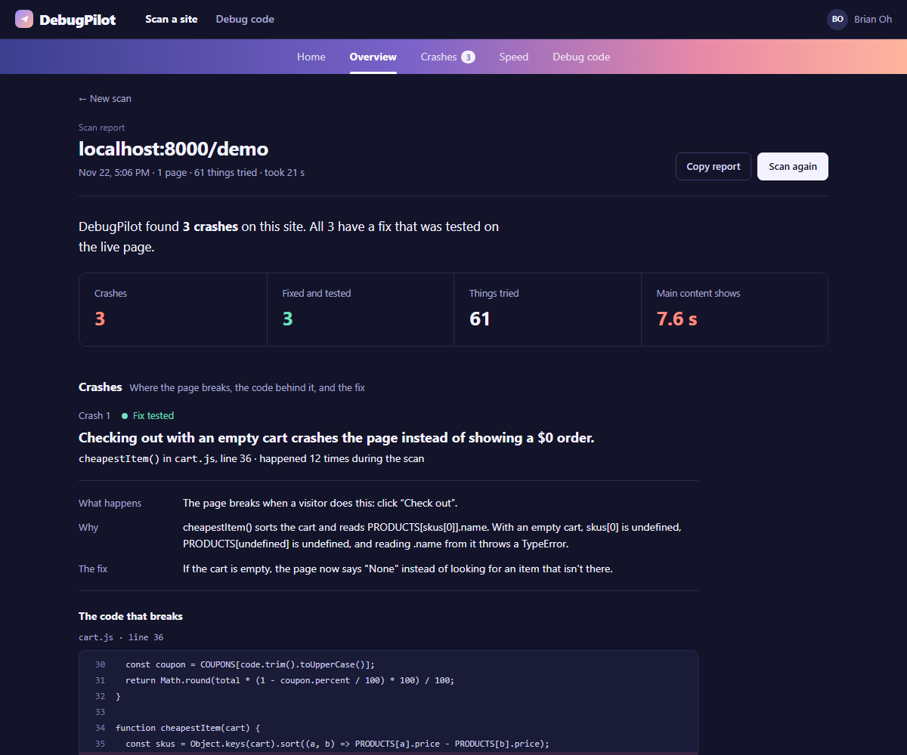
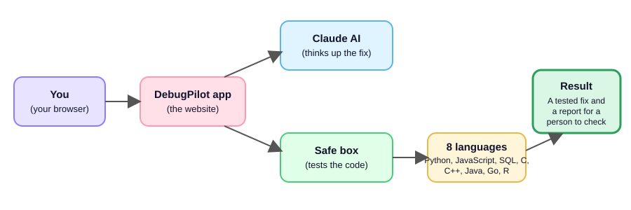

<p align="center">
  
</p>

# DebugPilot

**DebugPilot finds mistakes (bugs) and crashes in code and websites, shows exactly how to make them happen again, fixes them, and checks that the fix really works.**

## Start here

| I want to... | Go here |
|---|---|
| **Use the tool now** (free, nothing to install) | [Open the live app](https://debugpilot-x4kn.onrender.com/scan) |
| **See an example result** (nothing to install) | [Example report](https://brianohjiho-web.github.io/debugpilot/report/) |
| **Scan any page with one click** | [Chrome add-on](#add-it-to-chrome) |

---

## Use the full version

**To use the full version, you need to download all the files** and run them on your own computer. The live app online only does part of the job.

**Tip:** scans run **faster when you download the files** and run them on your own computer. The live app uses a small free server, so it can be slow and takes about a minute to wake up the first time.

---
## How it works

| | Step |
|---|---|
|  | **1. Look.** It reads your code, or opens your website and clicks buttons like a real person. |
|  | **2. Find a crash.** If something breaks, it writes down the exact steps that broke it. |
|  | **3. Make a fix.** It writes a small change to solve the problem. |
|  | **4. Check the fix.** It repeats the same steps. If the crash is gone, the fix is marked **tested**. |
|  | **5. You decide.** It never changes anything by itself. A person reads the fix first. |

---

## How to use it (the live app)

1. **Scan a website.** Open the [live app](https://debugpilot-x4kn.onrender.com/scan), type a full address like `https://example.com`, press scan and wait about a minute. The report shows each crash, why it happened and a fix.
2. **Use it on any page.** Add the Chrome extension (see below), then click it on any site.

**Good to know**
- The free server sleeps when nobody uses it, so the first visit can take a minute.
- Each visitor can run about 10 scans an hour.
- On the public site, Debug code only runs the built-in example. Pasting your own code is switched off for safety. To fix your own code, run DebugPilot on your computer with `start.bat`.
- Only scan websites you are allowed to test. A person should always read a fix before using it.

---
## What it looks like

**Scan a website.** Type a web address and press the search button.


**Read the report.** It shows each crash, what caused it, why it happened, and the fix.



**Fix your own code.** Paste code. It shows a test that fails, then a fix that passes.


---

## What are the files in the download?

You only need to touch **`start.bat`**. The rest is the engine inside.

| File or folder | Explanation |
|---|---|
| `start.bat` | **Double-click this to start.** It sets everything up and opens your browser. |
| `share.bat` | Optional. Makes a link so a friend can open your copy. |
| `.env.example` | A blank settings form. Copy it to `.env` and add your AI key to fix your own code. |
| `requirements.txt` | A shopping list of tools the app needs. `start.bat` installs them for you. |
| `server.py` | The app itself. It runs on your computer. |
| `agent/` | The "brain" that finds bugs and writes fixes. |
| `runner/` | The safe box where code is tested, so it can't harm your computer. |
| `web/` | The pages you see in your browser. |
| `extension/` | The Chrome add-on. |
| `watcher/` | A tiny script for watching your own website for crashes. |
| `demo-site/`, `demo-booking/`, `demo-power/` | Practice websites with bugs on purpose, so you can try it. |
| `docs/` | The public website and example report. |
| `tests/` | Checks that the app itself works. |
| `Dockerfile.*`, `docker-compose.yml` | For people who use Docker. You can ignore these. |

When you run it, it also makes a `data/` folder to save scan results. It is only on your computer.

---

## Add it to Chrome

Scan any page you are on with one click. DebugPilot must be running on your computer.

1. Open `chrome://extensions` in Chrome.
2. Turn on **Developer mode** (top right).
3. Click **Load unpacked** and pick the `extension` folder.
4. On any site, click the DebugPilot button and choose **Scan this page**.

---

## What it can do

### 1. Fix your code
Paste a file. You can add the error message too.

It works with **8 languages:** Python, JavaScript, SQL, C, C++, Java, Go and R.

What happens:
1. It loads your code to see if it even starts.
2. It asks Claude (an AI) what is wrong and how to fix it.
3. It runs a test on your **old** code. The test must **fail**. If it doesn't, the test is no good, so it tries again.
4. It runs the same test on the **fixed** code. The test must **pass**.
5. It shows a report: summary, cause, next steps, and the fix (what was removed and added).
6. If you want, it opens a **draft** pull request on GitHub. A person reviews it before it is merged.

Every fix runs in a locked-down safe box (a "sandbox"). Nothing is called "verified" unless it passed there.

### 2. Scan any website
No install needed on the website. Go to **Scan a site**, paste a link, press **Scan**.

1. **Visit.** A hidden browser clicks every button, leaves boxes empty, and types odd things.
2. **Catch.** Each crash is saved with the steps that caused it.
3. **Fix.** It reads the site's public code and writes a small fix.
4. **Prove.** It repeats the steps twice: with the real code (must crash), then with the fixed code (must not crash). Only then it says **Fix proven**.
5. **Speed check.** It loads the page like a phone on a slow 4G connection. You see how fast it starts, how big it is, and what is slow. For example: "this image is 1.5 MB, save it as WebP".
6. **Share.** Press **Copy report** to send it to the site's owner.

### 3. Scan equipment web pages (read-only)
Turn on **Equipment mode** to check the web pages inside data center equipment, like a power backup (UPS) page at `192.168.1.50`.

- It only opens pages and follows links. It **never** presses buttons or types.
- It never opens control pages (Shutdown, Reboot, Outlets, Self test, Settings).
- Anything that could change something is blocked. The report lists what was blocked.
- You must tick "I have permission to test this equipment".
- Local addresses only work when DebugPilot runs on your own computer.

Only scan equipment you are allowed to test.

### 4. Chrome extension
Scan the page you are looking at with one click.

1. Open `chrome://extensions`.
2. Turn on **Developer mode**.
3. Click **Load unpacked** and pick the `extension` folder.
4. On any site, click the DebugPilot button (or right-click) and choose **Scan this page**.

### 5. Autopilot for your own website
Add one line to your website:

```html
<script src="https://your-debugpilot/watch.js" data-key="YOUR_KEY" defer></script>
```

1. **Watch.** It catches crashes that visitors hit.
2. **Group.** The same crash from 500 visitors becomes one issue with a count of 500.
3. **Fix.** It reads the broken file from GitHub (or a folder) and runs the same prove-it steps.
4. **Approve.** Tested fixes become **draft** pull requests. Nothing ships until a person merges it. Fixes it can't prove are marked **Needs you**.

It also notices when the problem is **not** the code (for example, a broken sensor sending bad numbers). It says so instead of "fixing" code that works.

---

## For developers

### How the pieces fit

<p align="center"></p>

In short: you ask in your browser, the app asks Claude for a fix, and the safe box checks that the fix really works.

**Result:** you get a fix that was tested and a report. A person looks at it before anything changes.

### Folders

| Folder | What is in it |
|---|---|
| `agent/` | The main agent (`agent.py`), prompts, GitHub pull requests, one example bug per language |
| `agent/scanner.py` | Website scanner: explore, catch crashes, fix, prove, speed check |
| `agent/` (autopilot) | Crash grouping (`crashes.py`), storage (`store.py`), fix queue (`autofix.py`) |
| `runner/` | The sandbox: how each language is built and tested, and its limits |
| `web/` | The scan page, report page, and debugger page |
| `watcher/` | `watch.js`, the one-line crash catcher |
| `extension/` | The Chrome extension |
| `demo-site/` | "Little Shop", a demo site with 3 real bugs, a big image, and a slow API |
| `tests/` | 32 tests |

### How tests are written for each language

| Language | Test format |
|---|---|
| Python | `def test_...():` with `assert` |
| JavaScript | `function test_...()` with `assert(cond, msg)` |
| SQL | A `SELECT ... AS ok` check (SQLite) |
| C / C++ | A `main()` that returns 0 on pass |
| Java | A `TestMain` class that exits 1 on fail |
| Go | Normal `go test` functions |
| R | `test_...` functions using `stopifnot()` |

