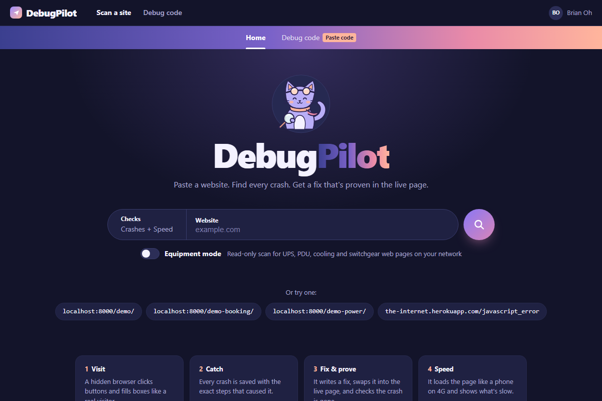

<p align="center">
  
</p>

# DebugPilot

**DebugPilot finds mistakes (bugs) in code and websites, then fixes them.**

Think of it like a spell checker, but for programs. A person always checks the fix before anything changes.

**Website:** https://brianohjiho-web.github.io/debugpilot/

**Example report (opens in any browser, nothing to install):** https://brianohjiho-web.github.io/debugpilot/report/

## Try it in one click

[](https://codespaces.new/brianohjiho-web/debugpilot?quickstart=1)

1. Click the button and sign in to GitHub (free accounts get free Codespaces hours each month).
2. Wait 2–3 minutes the first time while it sets up.
3. DebugPilot opens in a new tab. Click **Scan a site**, then try one of the example links.

Nothing to download. It runs in your own private copy in the cloud, and you can delete it any time from [github.com/codespaces](https://github.com/codespaces).

---

## How it works

| | Step |
|---|---|
|  | **1. Look.** It reads your code, or opens your website and clicks buttons like a real person. |
|  | **2. Find a crash.** If something breaks, it writes down the exact steps that broke it. |
|  | **3. Make a fix.** It writes a small change to solve the problem. |
|  | **4. Check the fix.** It repeats the same steps. If the crash is gone, the fix is marked **tested**. |
|  | **5. You decide.** It never changes anything by itself. A person reads the fix first. |

---

## What it looks like

**Scan a website.** Type a web address and press the search button.



**Read the report.** It shows each crash, what caused it, why it happened, and the fix.


**Fix your own code.** Paste code. It shows a test that fails, then a fix that passes.


---

## Try it on Windows

1. Install [Python](https://www.python.org/downloads/) (version 3.10 or newer). Tick **Add python.exe to PATH**.
2. Download this project and unzip it.
3. Double-click **`start.bat`**. The first time takes a few minutes.
4. Your browser opens. Click one of the "Or try one" links and press search.

**Good to know**
- The built-in example sites are free to scan.
- To fix your own code, you need an `ANTHROPIC_API_KEY`. Copy `.env.example` to `.env` and paste your key in it.
- Only scan websites you are allowed to test.

---

## Add it to Chrome

Scan any page you are on with one click. DebugPilot must be running on your computer.

1. Open `chrome://extensions` in Chrome.
2. Turn on **Developer mode** (top right).
3. Click **Load unpacked** and pick the `extension` folder.
4. On any site, click the DebugPilot button and choose **Scan this page**.

---

## What it can do

### 1. Fix your code
Paste a file. You can add the error message too.

It works with **8 languages:** Python, JavaScript, SQL, C, C++, Java, Go and R.

What happens:
1. It loads your code to see if it even starts.
2. It asks Claude (an AI) what is wrong and how to fix it.
3. It runs a test on your **old** code. The test must **fail**. If it doesn't, the test is no good, so it tries again.
4. It runs the same test on the **fixed** code. The test must **pass**.
5. It shows a report: summary, cause, next steps, and the fix (what was removed and added).
6. If you want, it opens a **draft** pull request on GitHub. A person reviews it before it is merged.

Every fix runs in a locked-down safe box (a "sandbox"). Nothing is called "verified" unless it passed there.

### 2. Scan any website
No install needed on the website. Go to **Scan a site**, paste a link, press **Scan**.

1. **Visit.** A hidden browser clicks every button, leaves boxes empty, and types odd things.
2. **Catch.** Each crash is saved with the steps that caused it.
3. **Fix.** It reads the site's public code and writes a small fix.
4. **Prove.** It repeats the steps twice: with the real code (must crash), then with the fixed code (must not crash). Only then it says **Fix proven**.
5. **Speed check.** It loads the page like a phone on a slow 4G connection. You see how fast it starts, how big it is, and what is slow. For example: "this image is 1.5 MB, save it as WebP".
6. **Share.** Press **Copy report** to send it to the site's owner.

You don't own the site, so you get a tested fix to hand over. Their code is not changed.

**Safety rules**
- It skips buttons that look like they spend money, delete things, or log out.
- It never sends forms that save data.
- It stays on one site (3 pages at most).
- It refuses private network addresses.

### 3. Scan equipment web pages (read-only)
Turn on **Equipment mode** to check the web pages inside data center equipment, like a power backup (UPS) page at `192.168.1.50`.

- It only opens pages and follows links. It **never** presses buttons or types.
- It never opens control pages (Shutdown, Reboot, Outlets, Self test, Settings).
- Anything that could change something is blocked. The report lists what was blocked.
- You must tick "I have permission to test this equipment".
- Local addresses only work when DebugPilot runs on your own computer.

Only scan equipment you are allowed to test.

### 4. Chrome extension
Scan the page you are looking at with one click.

1. Open `chrome://extensions`.
2. Turn on **Developer mode**.
3. Click **Load unpacked** and pick the `extension` folder.
4. On any site, click the DebugPilot button (or right-click) and choose **Scan this page**.

DebugPilot must be running. The extension talks to `http://localhost:8000`. You can change this in the popup's Settings.

### 5. Autopilot for your own website
Add one line to your website:

```html
<script src="https://your-debugpilot/watch.js" data-key="YOUR_KEY" defer></script>
```

1. **Watch.** It catches crashes that visitors hit.
2. **Group.** The same crash from 500 visitors becomes one issue with a count of 500.
3. **Fix.** It reads the broken file from GitHub (or a folder) and runs the same prove-it steps.
4. **Approve.** Tested fixes become **draft** pull requests. Nothing ships until a person merges it. Fixes it can't prove are marked **Needs you**.

It also notices when the problem is **not** the code (for example, a broken sensor sending bad numbers). It says so instead of "fixing" code that works.

---

## For developers

### How the pieces fit

```
Browser --> app (FastAPI + agent) --> Claude API
                  |
                  +--> runner (sandbox) --> runs code in Python, Node, gcc, g++, Java, Go, R, SQLite
```

### Folders

| Folder | What is in it |
|---|---|
| `agent/` | The main agent (`agent.py`), prompts, GitHub pull requests, one example bug per language |
| `agent/scanner.py` | Website scanner: explore, catch crashes, fix, prove, speed check |
| `agent/` (autopilot) | Crash grouping (`crashes.py`), storage (`store.py`), fix queue (`autofix.py`) |
| `runner/` | The sandbox: how each language is built and tested, and its limits |
| `web/` | The scan page, report page, and debugger page |
| `watcher/` | `watch.js`, the one-line crash catcher |
| `extension/` | The Chrome extension |
| `demo-site/` | "Little Shop", a demo site with 3 real bugs, a big image, and a slow API |
| `tests/` | 32 tests |

### How tests are written for each language

| Language | Test format |
|---|---|
| Python | `def test_...():` with `assert` |
| JavaScript | `function test_...()` with `assert(cond, msg)` |
| SQL | A `SELECT ... AS ok` check (SQLite) |
| C / C++ | A `main()` that returns 0 on pass |
| Java | A `TestMain` class that exits 1 on fail |
| Go | Normal `go test` functions |
| R | `test_...` functions using `stopifnot()` |

### Why the runner is a separate container
The code being fixed is not trusted. The runner has:
- no internet
- a read-only filesystem
- a 1 GB memory limit
- a process limit
- no extra Linux powers
- a non-root user
- a time limit, a CPU limit, and a throwaway folder for each run

### Run with Docker (recommended)

```bash
cp .env.example .env        # then paste your ANTHROPIC_API_KEY into .env
docker compose up --build
```

Open http://localhost:8000, pick a language, press **Load example**, then **Find and fix the bug**.

### Run without Docker (quick try)
Code runs on your own computer, so only paste code you trust.

```bash
pip install -r requirements.txt
export ANTHROPIC_API_KEY=...
uvicorn server:app --port 8000
```

Only languages installed on your computer will work.

### No API key?
The built-in example for each language still works in demo mode. The answer is prepared, but the sandbox still runs and checks it.

### Use it on your own website
1. Add your site and its GitHub repo with `POST /api/projects`.
2. Paste the script line it gives you into your pages.
3. If your site files are in a subfolder (like `public`), set **Site folder in the repo**.

For now, autopilot fixes JavaScript and TypeScript files.

### Draft pull requests
Add a `GITHUB_TOKEN` to `.env`. It needs **Contents** and **Pull requests** read/write access on the repos you choose. A form then appears under each verified fix.

### Run the tests

```bash
pip install -r requirements-dev.txt
pytest -q
```

Languages whose tools are not installed are skipped. The Docker image has them all.
