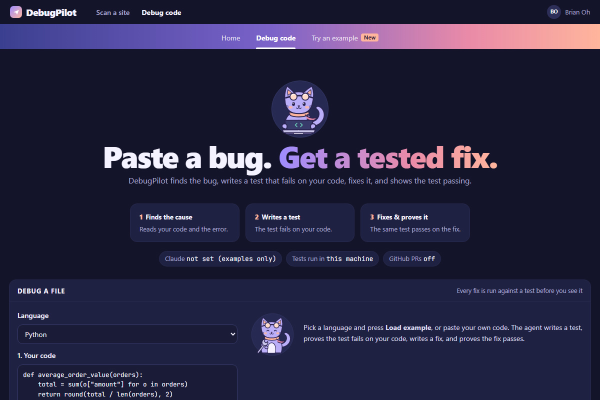

<p align="center">
  
</p>

# DebugPilot

## In simple words

**DebugPilot is a helper that finds mistakes (bugs) in code and websites, and then fixes them.**

Think of it like a spell checker, but for programs. Here is what it does:

| | |
|---|---|
|  | **1. It looks.** It reads your code, or opens your website and clicks the buttons like a real person. |
|  | **2. It finds a crash.** If something breaks, it writes down exactly what you did to make it break. |
|  | **3. It makes a fix.** It writes a small change that should solve the problem. |
|  | **4. It checks the fix.** It tries the same steps again. If the crash is gone, the fix is marked as tested. |
|  | **5. You decide.** A person always looks at the fix first. Nothing is changed on its own. |

### What it looks like

**Scan a website.** Type a web address and press the search button.


**Read the report.** It lists each crash, what you did to cause it, why it happened, and the fix.


**Fix your own code.** Paste code and the helper shows a test that fails, then a fix that passes.



### How to try it on Windows

1. Install [Python](https://www.python.org/downloads/) (version 3.10 or newer). Tick **Add python.exe to PATH**.
2. Download this project and unzip it.
3. Double-click **`start.bat`**. The first time takes a few minutes.
4. Your browser opens. Click one of the "Or try one" example links and press search.

You can scan the built-in example sites for free. To fix your own code you need an `ANTHROPIC_API_KEY`. Copy `.env.example` to `.env` and put your key in it.

Only scan websites you are allowed to test.

---

## The longer explanation

An AI agent that finds the bug in your code, **proves it with a test**, writes the fix, **proves the fix works**, and hands it to a human as a draft pull request.

It works with **8 languages**: Python, JavaScript, SQL, C, C++, Java, Go and R. Every fix is actually run in a locked-down sandbox before you see it. Nothing is called "verified" unless the sandbox passed it.

---

## Part 1: What it does

You paste a file and (optionally) the error you got. The agent:

1. **Loads the file as-is** to catch code that doesn't even compile.
2. **Asks Claude** for a summary, the root cause, next steps, a test, and a fixed file.
3. **Runs the test on your original code.** It must fail. If it passes, the test didn't catch the bug, so the agent sends the real results back to Claude and tries again.
4. **Runs the test on the fix.** It must pass, including a check that normal input still works.
5. **Shows a report:** 1. Summary, 2. Root cause, 3. Next steps, 4. The fix as a diff, with test results before and after.
6. **Opens a draft pull request** on GitHub if you want. Draft only: a person reviews and merges.

### Scan any website (nothing to install)

Go to **Scan a site** (`/scan`), paste any link, and press **Scan**.

1. **Visit.** A hidden browser opens the site and tries what visitors really do: clicks each button, leaves boxes empty, types odd values. Every try starts from a fresh page.
2. **Catch.** Every crash is recorded with the exact steps that caused it.
3. **Fix.** The agent reads the site's public script at the crash line and writes a small fix.
4. **Prove.** It repeats the same steps twice in the live page: once with the real script (must crash), once with the fixed script swapped in (must not crash). Only then is it marked **Fix proven**.
5. **Speed check.** Each page is loaded like a phone on 4G (the same setting Google's Lighthouse uses). You get server response time, when the main content shows, total size, and the slowest and biggest downloads, with plain tips like "this image is 1.5 MB, save it as WebP" or "this API call takes 1.4 s".
6. **Share.** **Copy report** gives you a clean write-up to send to the site's owner.

Since you don't own the site, you get a proven fix to hand over, not a change to their code.

**Safety:** it skips buttons that look like they spend money, delete things or log out, never submits forms that post data, stays on the same site (3 pages max), and refuses private network addresses.

### Equipment mode: UPS, PDU, cooling and switchgear pages

Turn on **Equipment mode** on the Scan page to check the web pages built into data center equipment (for example a UPS status page at `192.168.1.50`). It is **read-only**:

- It only opens pages and follows links and tabs. It never presses buttons or types anything.
- It never opens control pages (Shutdown, Reboot, Outlets, Self test, Settings and similar).
- Every request that could change something (anything other than a plain page load) is blocked before it leaves the browser. The report lists what was blocked.
- You must tick "I have permission to test this equipment", and local addresses are only allowed when DebugPilot runs on your own computer, never from a copy hosted online.

Only scan equipment you're allowed to test.

### Chrome extension: scan the page you're on

The `extension/` folder is a Chrome extension. On any website, click the DebugPilot button (or right-click the page) and choose **Scan this page**. The report opens in a new tab. No copy-pasting.

To install: open `chrome://extensions`, turn on **Developer mode**, click **Load unpacked**, and pick the `extension` folder. DebugPilot must be running (it talks to `http://localhost:8000`; change the address in the popup's Settings if you host it online).

### Website autopilot (sites you own)

Add one line to any website:

```html
<script src="https://your-debugpilot/watch.js" data-key="YOUR_KEY" defer></script>
```

1. **Watch.** `watch.js` catches crashes in visitors' browsers and sends them in (each error once per page view, 20 max).
2. **Group.** Crashes are grouped by error type + function + file, so 500 visitors hitting the same bug is one issue with a count of 500.
3. **Fix.** The agent reads that file from GitHub (or a local folder), and runs the same prove-it loop above.
4. **Approve.** Verified fixes become a **draft pull request**. Nothing ships until a person merges it. Unverified ones are marked *Needs you*.

It also knows when the problem **isn't the code** (for example a broken sensor sending impossible values) and says so instead of "fixing" code that's working correctly.

## Part 2: How it's built

```
Browser ──► app (FastAPI + agent) ──► Claude API
                    │
                    └──► runner (sandbox) ── runs code in Python, Node, gcc, g++, Java, Go, R, SQLite
```

| Folder | What's in it |
|---|---|
| `agent/` | The agent loop (`agent.py`), the prompts (`prompts.py`), GitHub PRs (`github.py`), one example bug per language (`examples.py`) |
| `runner/` | The sandbox: how each language is compiled and tested (`languages.py`), process limits (`sandbox.py`), its own small API (`app.py`) |
| `web/` | The scan page, the result page, and the debugger page |
| `watcher/` | `watch.js`, the one-line crash watcher for websites |
| `agent/` (autopilot) | Crash parsing and grouping (`crashes.py`), the SQLite store (`store.py`), the fix queue and Apply (`autofix.py`) |
| `agent/scanner.py` | Scan a website: explore, catch crashes, fix, prove the fix in the live page, and run the speed check |
| `extension/` | Chrome extension: one-click 'Scan this page' and a right-click menu item |
| `demo-site/` | Little Shop, a demo website with 3 real bugs to break, plus a 1.5 MB banner and a slow API for the speed check to find |
| `tests/` | 32 tests: every language's example fails before and passes after, the agent's retry logic, the API, the full website loop (crash → issue → verified fix → apply → reset), and the scanner on a site it doesn't own (a fix that still crashes is never called proven) |

**Why the runner is a separate container:** the code being debugged is untrusted. The runner container has **no internet** (internal-only network), a read-only filesystem, a 1 GB memory cap, a process limit (stops fork bombs), no Linux capabilities, and runs as a non-root user. Each run also gets a time limit, a CPU limit and a throwaway folder.

**How each language is tested**

| Language | Test format the agent writes |
|---|---|
| Python | `def test_...():` with `assert` |
| JavaScript | `function test_...()` with `assert(cond, msg)` |
| SQL | A `SELECT ... AS ok` check against the query's output (SQLite) |
| C / C++ | A `main()` that returns 0 on pass |
| Java | A `TestMain` class that exits 1 on failure |
| Go | Standard `go test` functions |
| R | `test_...` functions using `stopifnot()` |

## Part 3: Run it

**With Docker (recommended: code runs in the sandbox container)**

```bash
cp .env.example .env        # then paste your ANTHROPIC_API_KEY into .env
docker compose up --build
```

Open http://localhost:8000, pick a language, press **Load example**, then **Find and fix the bug**.

**Without Docker (quick try; code runs on your own machine, so only paste code you trust)**

```bash
pip install -r requirements.txt
export ANTHROPIC_API_KEY=...
uvicorn server:app --port 8000
```

Only the languages installed on your machine will work this way.

**No API key?** The built-in example for each language still works in demo mode, using a prepared answer that is still run and checked by the sandbox.

**Your own website:** add a site with its GitHub repo through the API (`POST /api/projects`), then paste the line it returns into your pages. Set "Site folder in the repo" if your site's files live in a subfolder (like `public`). For now the autopilot fixes JavaScript and TypeScript files.

**Pull requests:** add a fine-grained `GITHUB_TOKEN` to `.env` with *Contents* and *Pull requests* read/write access on the repos you choose. A form appears under any verified fix.

## Part 4: Tests

```bash
pip install -r requirements-dev.txt
pytest -q
```

Languages whose tools aren't installed are skipped; the Docker image has all of them.

## Part 5: Limits and next steps

- One file at a time, and no outside services (databases, websites) during tests.
- The PR endpoint trusts the report sent by the browser, which is fine for a tool you run yourself. A hosted, multi-user version should keep reports on the server and look them up by ID.
- The scanner can't reach pages behind a login, and it only fixes crashes in scripts it can download (not inline scripts or browser extensions).
- The scanner runs Chromium without its own sandbox inside the container. For a public, multi-user deployment, run scans in a separate locked-down container like the runner.
- The autopilot reads the file named in the stack trace. Minified sites need source maps (not yet supported).
- Website crash intake has a basic per-key rate limit. A hosted version would add login for the dashboard.
- Next: source maps, server-side crashes (Python/Node logs), multi-file fixes, and a Slack message when a fix is ready.
